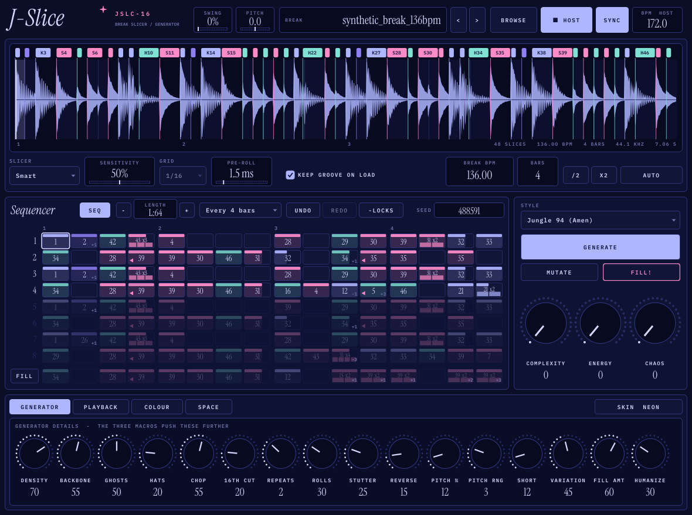
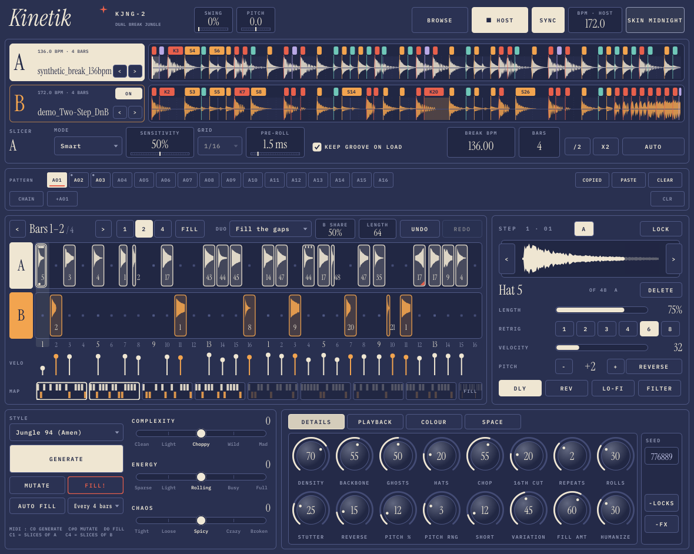

# Kinetik Jungle · KJNG-2

**Slicer + générateur de rythmiques jungle / drum and bass à deux breaks** (VST3 et Audio Unit pour
Ableton Live et les autres DAW, Windows et Mac). Anciennement *J-Slice* : c'est le même plugin
sous un nouveau nom, les projets Ableton qui utilisaient J-Slice s'ouvrent avec Kinetik Jungle
(désinstalle l'ancien `J-Slice.vst3` / `J-Slice.component`).

Tu charges un break de batterie (A) et, si tu veux, un deuxième (B). Kinetik Jungle les découpe aux
bons endroits, reconnaît les kicks / snares / hats / ghost notes, puis génère une séquence dans le
style choisi (Jungle 94, Ragga, Rinse-Out Choppage, Two-Step, Rollers, Liquid, Neurofunk, Halftime,
Drumfunk, Breakcore), synchronisée au tempo d'Ableton. Les deux breaks **s'emboîtent** : chaque pas
appartient à A ou à B, jamais aux deux.




## Télécharger et installer

Page **Releases** du dépôt → **latest** (https://github.com/Kozzzmo/J-Slice/releases/tag/latest).

### Windows
1. Télécharge `Kinetik-Jungle-Windows.zip`, dézippe.
2. Copie **tout le dossier** `Kinetik Jungle.vst3` dans `C:\Program Files\Common Files\VST3`
   et **supprime l'ancien `J-Slice.vst3`** (même plugin, ancien nom).
3. Ableton Live 12 : *Settings → Plug-Ins* → **Use VST3 Plug-In System Folders** → **Rescan**.

### Mac (Apple Silicon et Intel, macOS 11+) : VST3 et Audio Unit
1. Télécharge `Kinetik-Jungle-macOS.zip`, dézippe.
2. Ouvre le **Terminal**, tape `bash ` (avec un espace), glisse `install.sh` du dossier dans la
   fenêtre, puis Entrée. Le script installe le VST3 et l'AU, retire l'ancien J-Slice et lève le
   blocage de macOS (le plugin n'est pas signé par Apple).
3. Ableton Live 12 : *Settings → Plug-Ins* → **Use Audio Units** et/ou **Use VST3 Plug-In System
   Folders** → **Rescan**.

Puis *Plug-Ins → Kozzzmo → Kinetik Jungle* : glisse-le sur une piste MIDI. Les zips contiennent
aussi une version autonome (`Kinetik Jungle.exe` / `.app`) pour tester sans Ableton.

## Prise en main en 30 secondes

1. Clique sur la carte **A** (ou glisse un fichier sur la forme d'onde A, ou **BROWSE**).
2. Choisis un **STYLE** en bas à gauche : ça charge ses réglages et génère un pattern.
3. Lance Ableton (ou **PLAY**). Bouge **COMPLEXITY / ENERGY / CHAOS** : tu entends le changement
   tout de suite.
4. Charge un deuxième break sur la ligne **B** : un second générateur place ses frappes dans les
   trous du break A. Choisis comment ils se partagent le groove avec **DUO**.

## L'interface

### En-tête
- **SWING**, **PITCH** : glisser haut/bas, molette, double-clic pour taper.
- **BROWSE** : navigateur de fichiers (favoris, chargement au clic, flèches pour écouter les breaks
  un par un). Il charge dans le break sélectionné (A ou B).
- **SYNC** (allumé par défaut) : suit le tempo et la position de mesure d'Ableton.
  Éteint : tempo libre (case **BPM**).
- **SKIN** : NEON, MIDNIGHT ou AMEN.

### Les deux breaks
- **Carte A / B** : tempo détecté, nombre de mesures et de slices, nom du fichier, **< >** = fichier
  précédent / suivant du même dossier. Cliquer une carte la sélectionne : la ligne **SLICER** en
  dessous règle alors ce break. **ON** (carte B) : allume / éteint le break B.
- **Forme d'onde** : étiquettes **K** kick, **S** snare, **H** hat, **G** ghost. Clic = écouter une
  slice, glisser un marqueur = le déplacer, **double-clic sur une étiquette = supprimer la slice**,
  double-clic dans la forme d'onde = ajouter un marqueur, clic droit = classe / supprimer.
- **SLICER** *Smart / Transient / Grid*, **SENSITIVITY**, **GRID**, **PRE-ROLL**, **BREAK BPM**,
  **BARS**, **/2**, **x2**, **AUTO** : la découpe se met à jour en direct.

### Patterns A01 à A16 et CHAIN
- **A01 … A16** : 16 patterns. Clic = éditer ce slot ; pendant la lecture, il démarre quand le
  pattern en cours arrive à sa fin. Chaque slot garde ses pas, sa longueur et ses réglages du
  générateur (style, macros, détails, swing, fill, DUO). Les deux breaks sont communs.
- **COPY / PASTE / CLEAR** : copier un slot dans un autre, vider le slot.
- **CHAIN** : joue la liste en boucle ; **+A0x** ajoute le slot édité, clic sur une puce = une
  répétition de plus, clic droit = la retirer, **CLR** vide la chaîne.

### Les pistes (séquenceur)
Deux pistes horizontales : **A** en haut, **B** en dessous. Chaque frappe montre la forme de sa
slice et son numéro. On voit 1, 2 ou 4 mesures (**ZOOM 1 2 4**), **< >** change de page, **FILL**
affiche la mesure de fill, la **MAP** en bas montre les 8 mesures (clic = y aller), la ligne
**VELO** règle la vélocité (clic ou glisser).

| Geste | Action |
|------|--------|
| Clic sur une case vide | ajouter une frappe du break de cette piste (et la sélectionner) |
| Clic sur une frappe | la sélectionner et l'écouter |
| Glisser une frappe gauche / droite | raccourcir / rallonger |
| Glisser une frappe haut / bas | re-triggers (x1 à x8) |
| **Clic droit** | ajouter une frappe **à l'envers** (ou inverser une frappe) |
| Double-clic ou touche Suppr | effacer la frappe |
| Molette ou flèches gauche / droite | slice précédente / suivante |
| Flèches haut / bas | vélocité |
| Shift + clic | verrouiller |

**DUO** (comment B partage les pas avec A) :
- *Fill the gaps* : B joue là où A se tait, et peut reprendre une partie de ses hats / ghosts ;
  A garde toujours ses kicks et snares.
- *Call / response* : A joue la première moitié de chaque mesure, B répond dans la deuxième.
- *Split roles* : A garde les kicks et les snares, B joue les hats et les ghosts.

**B SHARE** : la place laissée à B. **LENGTH** : longueur du pattern en pas (16 = 1 mesure, jusqu'à
128). **UNDO / REDO**.

### L'inspecteur (à droite des pistes)
Tout sur la frappe sélectionnée, écrit en clair : break **A/B** (cliquer pour la passer à l'autre
break), **LOCK**, forme d'onde de la slice avec **< >**, nom de la slice, **LENGTH**, **RETRIG**
1 2 3 4 6 8, **VELOCITY**, **PITCH − +**, **REVERSE**, **DELETE**, et les effets par pas :
**DLY** / **REV** (envoie seulement cette frappe dans le delay / la reverb, l'effet s'allume tout
seul), **LO-FI** (8 kHz / 5 bits), **FILTER** (filtre « téléphone »).

### Générateur (en bas à gauche)
- **STYLE**, **GENERATE** (nouveau pattern, les pas verrouillés sont gardés), **MUTATE**,
  **FILL!** (fill à la mesure suivante), **AUTO FILL** + *Every 2 / 4 / 8 bars*.
- **Faders à zones** :
  - **COMPLEXITY** *Clean / Light / Choppy / Wild / Mad* : découpe, coupes en 1/16, rolls, fills ;
  - **ENERGY** *Sparse / Light / Rolling / Busy / Full* : densité, ghosts, hats ;
  - **CHAOS** *Tight / Loose / Spicy / Crazy / Broken* : bégaiements, reverse, pitch, frappes courtes.

  **Au centre, le style est joué tel quel** ; à gauche on retire (tout à gauche : une ou deux
  frappes par mesure pour ENERGY), à droite on pousse jusqu'au maximum. Ils agissent **en direct**
  sur le même pattern (même graine) : monter ajoute, redescendre retire, sans tout rebattre. Les pas
  modifiés à la main et les pas verrouillés ne bougent pas. Crans doux sur chaque zone, clic sur un
  nom de zone pour y aller, double-clic = retour au centre.

### Onglets (en bas à droite)
- **DETAILS** : Density, Backbone, Ghosts, Hats, Chop, 16th cut, Repeats, Rolls, Stutter, Reverse,
  Pitch %, Pitch range, Short, Variation, Fill amount, Humanize, **SEED**, **-LOCKS**, **-FX**.
- **PLAYBACK** : **TEMPO MODE** (*Repitch* vintage, *Slice*, *Cyclic stretch* façon Akai,
  *Stretch* propre) et **GRAIN**, **VOICES** Mono/Poly, **SLICE TAIL**, **ATTACK**, **TIGHT**,
  **VELOCITY**, **SEQUENCER** on/off, **NEXT BAR**.
- **COLOUR** : **VINTAGE** (bits / fréquence), **FILTER**, **DRIVE**, **SQUASH** (compression
  parallèle).
- **SPACE** : **DELAY** synchronisé (ping-pong, source : tout / snares + pas marqués / pas marqués),
  **REVERB**, **OUTPUT**.

Les potards (« palets ») affichent leur valeur au centre ; double-clic = valeur par défaut.

## Contrôle MIDI et automation

| Note | Action |
|------|--------|
| C1 (36) et au-dessus | joue la slice 1, 2, 3… du break **A** |
| C4 (72) et au-dessus | joue la slice 1, 2, 3… du break **B** |
| C0 (24) | GENERATE |
| C#0 (25) | MUTATE |
| D0 (26) | FILL à la mesure suivante |
| D#0 (27) | UNDO |
| E0 (28) | séquenceur on/off |

Tous les paramètres sont automatisables (dont les macros, DUO, B SHARE et B ON).
*Trigger: generate / mutate / fill* sont des paramètres « boutons » pour Push, un contrôleur MIDI ou
une enveloppe de clip.

## Mises à jour

Clic sur le logo : version installée, recherche d'une nouvelle version (automatique une fois par
jour si activée, rien n'est envoyé). Quand une version sort, « UPDATE … - CLICK » s'affiche sous le
logo et le bouton ouvre la page de téléchargement.

## Les breaks et le projet Ableton

Les fichiers audio sont **intégrés dans le projet** (copie FLAC dans l'état du plugin) : si tu
déplaces le WAV ou ouvres le projet sur un autre ordinateur, les breaks sont toujours là.
Les projets sauvés avec J-Slice s'ouvrent dans Kinetik Jungle (le break devient le break A).

## Comment ça marche

Voir [docs/RECHERCHE.md](docs/RECHERCHE.md) : la recherche sur la jungle / DnB (breaks, chopping,
samplers Akai, patterns two-step / halftime / neuro, algorithme de découpe de Nick Collins) et
comment chaque point a été traduit dans le plugin.

| Fichier | Rôle |
|---------|------|
| `Source/Core/Analyzer.*` | détection d'attaques multi-bandes, tempo, découpe Smart/Transient/Grid, classification |
| `Source/Core/Generator.*` | styles, génération (découpe Collins + squelette + gabarits), duo A/B, mutation, remap |
| `Source/Core/Engine.*` | lecteur temps réel : séquenceur synchronisé, deux breaks, voix, effets |
| `Source/Core/Exporter.h` | export MIDI et rendu audio |
| `Source/PluginProcessor.*` | paramètres, état, chargement des deux breaks, macros en direct, slots A01-A16 et chaîne, historique |
| `Source/PluginEditor.*`, `Source/UI/*` | interface (cartes, formes d'onde, slots, pistes, inspecteur, faders, palets, mises à jour) |
| `Tests/TestMain.cpp` | tests automatiques (tempo, découpe, classes, génération, duo, macros, rendu) |
| `Tests/Harness.cpp` | test d'intégration du plugin complet + captures d'écran (Linux) |

## Compiler soi-même

Pré-requis : CMake ≥ 3.22, Visual Studio 2022 (Windows) ou Xcode (Mac). JUCE 8 est téléchargé
automatiquement.

```
cmake -B build -A x64
cmake --build build --config Release --target JSlice_VST3
```

Sur Mac : `cmake -B build -DCMAKE_OSX_ARCHITECTURES="arm64;x86_64"` puis
`cmake --build build --config Release --target JSlice_AU JSlice_VST3`.

Chaque push sur `main` lance la compilation sur GitHub Actions et met à jour la release **latest**.

## Licence

Logiciel propriétaire, tous droits réservés (voir `LICENSE`). Kinetik Jungle utilise le framework [JUCE](https://juce.com)
sous la licence JUCE 8 (offre « Starter » gratuite jusqu'à 20 000 $ de revenus annuels, à vérifier dans le contrat JUCE),
avec le SDK VST3 sous licence MIT (JUCE 8.0.15 et suivants). Les composants tiers et leurs licences sont listés
dans `THIRD_PARTY_NOTICES.txt`, à livrer avec chaque version. Polices : Instrument Serif et IBM Plex Mono (SIL OFL).
VST est une marque de Steinberg Media Technologies GmbH.
